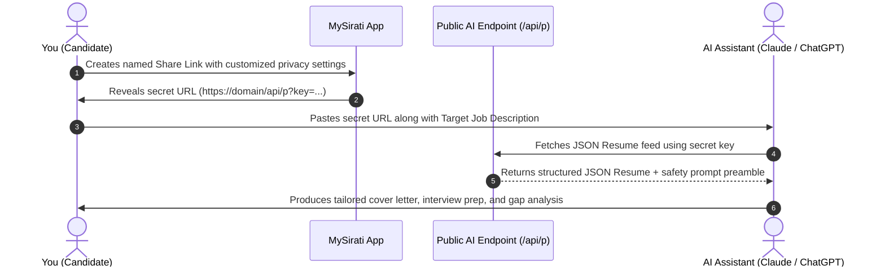

# AI Resume Integration Overview

Traditional PDF resumes are static documents that can be difficult for automated systems to parse accurately. MySirati transforms your career history into an **AI-first API endpoint** optimized for modern Large Language Models (LLMs) such as Claude 3.5 Sonnet, ChatGPT (GPT-4o), and Google Gemini 1.5 Pro.

---

## How It Works

---

## Key Benefits

1. **Structured Data Over Parsing Heuristics**: Instead of relying on unreliable PDF parsing, the AI receives clean, unambiguous JSON fields with explicit dates and categories.
2. **Granular Privacy**: Choose exactly which sections, projects, or work roles are shared for each application.
3. **Instant Revocation**: If a hiring process concludes, you can revoke or regenerate the link immediately with zero leftover traces.
4. **LLM Safety Preamble**: Every JSON payload is prefixed with an automated security notice instructing the AI assistant not to reveal private contact details unless expressly authorized.
