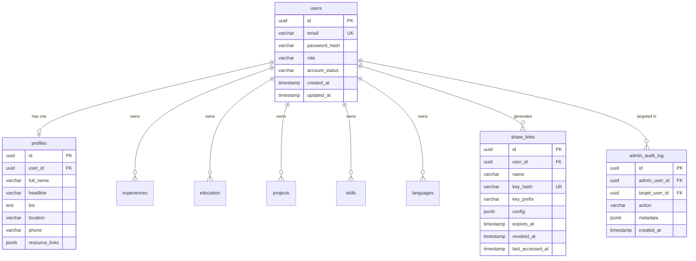

# Database Schema & Data Models

MySirati uses **PostgreSQL 16** managed through **Drizzle ORM** with TypeScript type safety and deterministic SQL migrations (`drizzle-kit`).

---

## Entity Relationship Overview

---

## Core Tables

1. **`users`**: Authentication credentials, roles (`'user'` \| `'admin'`), account status (`'active'` \| `'suspended'`), and timestamps.
2. **`profiles`**: Personal details, headlines, bio, contact details, and external portfolio links.
3. **`experiences`**: Work history, company, role, date ranges, current status, description, and links.
4. **`education`**: Academic institutions, degree types, study areas, graduation dates, and credential links.
5. **`projects`**: Project titles, summaries, keyword arrays, repository links, and live demos.
6. **`skills`**: Skill names, proficiency ratings, and categories.
7. **`languages`**: Language names and fluency ratings.
8. **`share_links`**: Named export links, SHA-256 key hash, 6-char key prefix, granular JSONB config, and revocation timestamps.
9. **`admin_audit_log`**: Append-only audit trail recording every administrative inspection, status change, and link revocation.
