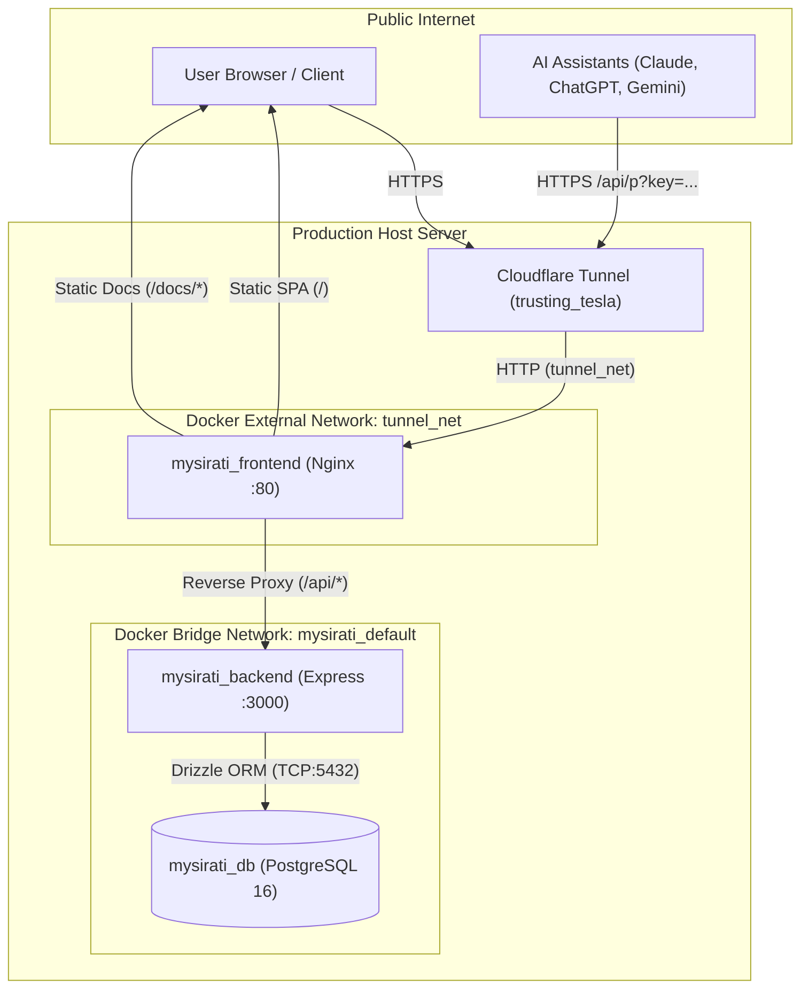

# System Architecture & Design

MySirati is built on a multi-tier, containerized architecture that separates client presentation, business logic, persistence, and external networking.

---

## Topology Diagram

---

## Key Components

### 1. Frontend & Reverse Proxy (`mysirati_frontend`)
- **Web Server**: Nginx on Alpine Linux (`nginx:alpine`).
- **SPA Routing**: Serves the compiled React 18 / Vite application with HTML5 history fallback.
- **Documentation Routing**: Directly serves VitePress static documentation at `/docs/`.
- **API Proxy**: Reverse-proxies `/api/` traffic to the backend, eliminating cross-origin CORS preflight overhead (`DEC-005`).

### 2. Backend Application Service (`mysirati_backend`)
- **Runtime**: Node.js 26 (`node:26-slim`) running as an unprivileged system user (`node`).
- **Framework**: Express with strict ES Modules.
- **Data Access**: Drizzle ORM connecting to PostgreSQL via pooled TCP sockets.
- **Security & Logging**: Helmet headers, Express Rate Limiter, and Pino structured JSON logging.

### 3. Database Layer (`mysirati_db`)
- **Database**: PostgreSQL 16 Alpine.
- **Network Isolation**: Accessible solely on the internal `mysirati_default` bridge network; no host ports are exposed in production (`TASK-1101`).
- **Volume**: Data stored in isolated Docker named volume `mysirati_postgres_data`.
