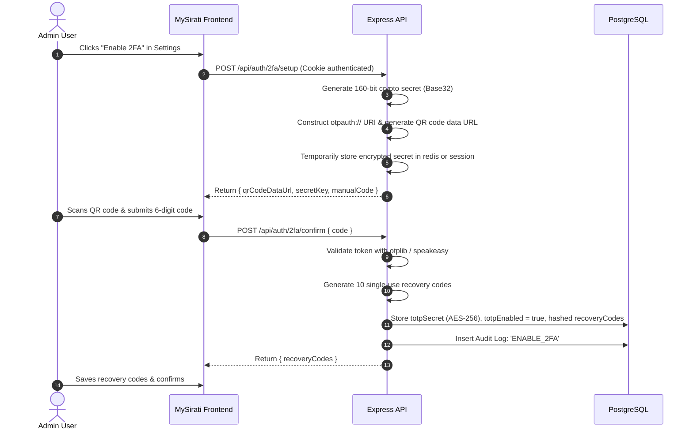

# Two-Factor Authentication (TOTP) Roadmap & Architecture (TASK-1103)

This document establishes the technical blueprint, security specifications, and integration roadmap for implementing RFC 6238 Time-Based One-Time Password (TOTP) multi-factor authentication for administrative accounts on the MySirati platform.

---

## 1. Objectives & Scope
- **Target Role**: Mandatory for all accounts with `role: 'admin'`; optional opt-in for standard user accounts.
- **Client Compatibility**: Standard authenticator apps (Google Authenticator, Microsoft Authenticator, 1Password, Authy, Apple Passwords).
- **Core Standard**: RFC 6238 (HMAC-SHA1, 30-second timestep, 6-digit verification codes, ±1 timestep drift tolerance).

---

## 2. Database Schema Extension

Extend `usersTable` in `backend/src/db/schema.ts`:

```typescript
// Proposed additions to usersTable
totpSecret: varchar('totp_secret', { length: 255 }), // Encrypted with AES-256-GCM using app ENCRYPTION_KEY
totpEnabled: boolean('totp_enabled').default(false).notNull(),
totpEnrolledAt: timestamp('totp_enrolled_at', { withTimezone: true }),
recoveryCodes: jsonb('recovery_codes').$type<string[]>().default([]).notNull(), // Argon2id or SHA-256 hashed single-use codes
```

---

## 3. Provisioning & Enrollment Flow



---

## 4. Intercepted Login Flow

When a user with `totpEnabled: true` logs in via `POST /api/auth/login`:

1. **Step 1 (Password verification)**:
   - Password is confirmed via Argon2id.
   - Instead of issuing the standard 7-day session cookie, backend issues a temporary, short-lived (5-minute) cookie: `mysirati_2fa_pending` containing a signed HMAC token `{ userId, state: 'awaiting_totp' }`.
   - Response payload: `{ require2fa: true }`.

2. **Step 2 (Code submission)**:
   - User inputs 6-digit code on the `/login/2fa` challenge screen.
   - Frontend calls `POST /api/auth/2fa/verify { code }` (or provides a recovery code).
   - Backend verifies the TOTP token against the decrypted `totpSecret`.
   - Upon verification, the temporary cookie is cleared, and the final `mysirati_session` cookie is issued.
   - If a recovery code is used, it is consumed, removed from `recoveryCodes`, and an audit event `USE_RECOVERY_CODE` is recorded.

---

## 5. Security Safeguards

1. **Secret Storage**: Plaintext TOTP secrets are **never** stored in database columns. They are encrypted using an application-level key (`AES-256-GCM` with random IV).
2. **Replay Protection**: The backend tracks the last verified timestep for each user to prevent replay attacks within the 30-second window.
3. **Rate Limiting**: `POST /api/auth/2fa/verify` is bound to the strict `authRateLimiter` (max 5 invalid attempts per 15 minutes per IP).
4. **Audit Logging**: Any enrollment, disabling, or recovery code usage writes directly to `admin_audit_log` with client IP.
